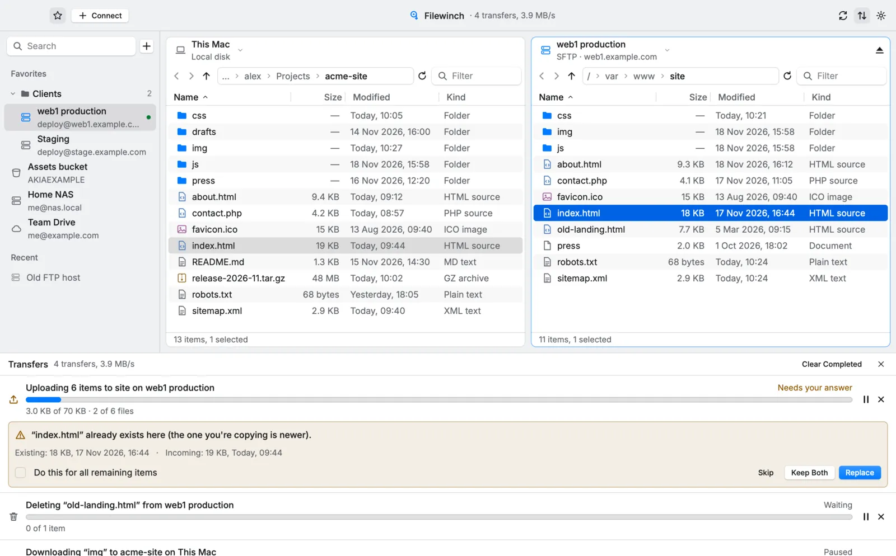

# Filewinch

A native file-transfer app for macOS, Windows and Linux: your computer on one side, a server or
cloud drive on the other, and a transfer queue that resumes, retries and asks before it
overwrites anything.

<p align="center">
  <picture>
    <source media="(prefers-color-scheme: dark)" srcset="site/assets/shots/macos-transfers-dark.webp">
    
  </picture>
</p>

**[Website and downloads](https://xploredatum.github.io/filewinch/)** ·
**[Releases](https://github.com/XploreDatum/filewinch/releases)** ·
**[Changelog](CHANGELOG.md)**

## What it connects to

SFTP (passwords, keys, ssh-agent, `~/.ssh/config`), FTP and FTPS, WebDAV, Amazon S3 and
S3-compatible services (Cloudflare R2, MinIO, Wasabi, DigitalOcean Spaces), Backblaze B2,
Azure Blob Storage, OpenStack Swift, Google Drive, Dropbox, OneDrive and Box.

## What it does

- **Two panes** with Favorites, back/forward, filter, sortable and resizable columns, Get Info
  with a permissions editor, and drag and drop with Finder, File Explorer or Files.
- **A transfer queue** that runs jobs in parallel, pauses, cancels, retries with backoff,
  resumes partial files, limits bandwidth, and asks what to do when a file already exists.
- **Folder sync** that shows its plan before changing anything, comparing by size and date,
  size only, or checksum.
- **Edit in place** in your own editor; each save uploads again.
- **Trust is explicit:** unknown SSH host keys and self-signed certificates show their
  fingerprint before you connect. Passwords live in the system's secret store (Keychain,
  Windows Credential Manager, or the desktop keyring), never in files.
- **Shared cloud folders are safe:** deleting one leaves the share instead of emptying it for
  everyone else.
- **Native on each platform:** the macOS look with your accent colour, Windows 11 Fluent, and
  GNOME (Adwaita) or KDE (Breeze) on Linux, in light and dark, with screen-reader support.

## Price

Filewinch is **free to use, with every feature and no time limit**. A small banner offers a
one-time **US$14 licence** (plus tax, sold through Polar) that supports development and removes
the banner. [Buy a licence](https://xploredatum.github.io/filewinch/buy.html).

## Building from source

You need Rust (the version in `rust-toolchain.toml` is picked up automatically by rustup).
On Linux, install the packages listed in `.github/actions/setup/action.yml`.

```sh
cargo run --release -p filewinch-app      # build and launch
cargo test --workspace                    # tests (FTP, SFTP, WebDAV and S3 tests use rclone)
```

The UI is built with [Rune](https://github.com/anomalyco/rune), pinned to a revision in
`Cargo.toml`. Packaging and release steps are in [docs/RELEASING.md](docs/RELEASING.md).

Google Drive, Dropbox, OneDrive and Box sign-in need OAuth client IDs of your own when you build
from source; see [docs/oauth-setup.md](docs/oauth-setup.md).

## Licence

Copyright © 2026 XploreDatum Technologies LLP. Filewinch is free software under the
[GNU Affero General Public License v3.0 or later](LICENSE). Third-party licences are listed in
[THIRD-PARTY-NOTICES.md](THIRD-PARTY-NOTICES.md) and in the app's About window.

Protocol and service names are trademarks of their owners; Filewinch isn't affiliated with or
endorsed by them.
